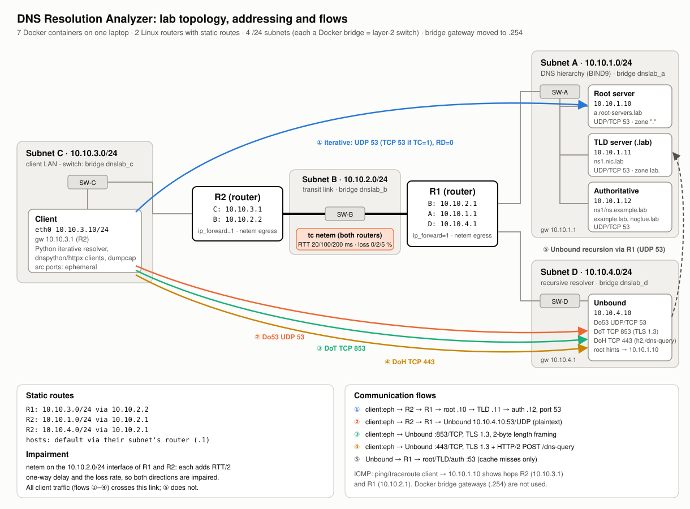

# DNS Resolution Analyzer

An iterative resolver built from raw packets, plus a comparison of DoT and DoH with classic DNS (Project 17).

We built an iterative DNS resolver in Python that encodes and parses DNS messages in raw wire format, using no DNS library. We run it against a local DNS hierarchy (root, `.lab` TLD, `example.lab` authoritative). Then we measure what encryption costs by comparing Do53, DNS over TLS and DNS over HTTPS through Unbound. All of this runs on a routed Docker topology (2 routers, 4 subnets), with `tc netem` adding delay and loss on the transit link.



| Deliverable | Where |
|---|---|
| Architecture diagram + addressing plan | [docs/architecture.svg](docs/architecture.svg), [Addressing](#addressing-plan) |
| Working POC | `docker compose up`, then [scripts/dashboard.py](scripts/dashboard.py) (web dashboard) or [scripts/demo.py](scripts/demo.py) (terminal) |
| Packet captures (.pcapng) | [captures/evidence/](captures/evidence/) (from [scripts/capture_evidence.py](scripts/capture_evidence.py)) |
| Annotated Wireshark screenshots | [captures/screenshots/wireshark/](captures/screenshots/wireshark/) (each image names its trace and display filter) |
| Experiment table (≥3 conditions, 3 runs, mean ± sd, range) | [results/experiment_table.md](results/experiment_table.md), [results/plots/](results/plots/) |
| Technical report | [docs/REPORT.pdf](docs/REPORT.pdf), [docs/REPORT.docx](docs/REPORT.docx) (Word) |
| Plain-language project summary | [docs/PROJECT_SUMMARY.docx](docs/PROJECT_SUMMARY.docx) |
| Code and file guide (what every file does) | [docs/CODE_GUIDE.docx](docs/CODE_GUIDE.docx) |
| AI-use disclosure | [AI_DISCLOSURE.md](AI_DISCLOSURE.md) |

---

## 1. Requirements

* Docker with Compose v2: Docker Desktop on Windows/macOS, or Docker Engine on Linux. You need about 2 GB of disk for the image.
* Python 3.8+ on the host, standard library only. It runs the orchestration scripts, which call `docker exec`.
* Wireshark 4.x (optional) for viewing the captures.
* Internet access the first time only, so the image can install packages.

Everything else (BIND9, Unbound, OpenSSL, dumpcap/tshark, dnspython, pandas, matplotlib) is inside the single lab image ([docker/Dockerfile](docker/Dockerfile)), and every Python package version is pinned.

## 2. Repository layout

```
docker-compose.yml        topology: 4 networks, 7 containers, fixed IPs; the image is built once (by r1)
docker/Dockerfile         one image for every node (role chosen by command)
docker/entrypoints/       router.sh (static routes), host.sh (default gw),
                          unbound.sh (certs + Unbound), netem.sh (impairment)
config/bind/{root,tld,auth}/  named.conf + zone files of the hierarchy
config/unbound/           unbound.conf (Do53/DoT/DoH), root.hints
resolver/dnsresolver/     OUR RESOLVER: message.py (wire format), resolver.py (iteration)
resolver/tests/           unit tests (encoding, compression, cross-check with dnspython)
experiments/              code run in the client: measure.py, transports.py,
                          evidence.py, verify.py, compare.py, common.py
scripts/                  host orchestration: run_experiments.py, capture_evidence.py, demo.py, lab.py,
                          dashboard.py + dashboard.html (web dashboard for the live demo)
analysis/                 analyze.py (statistics, table, graphs)
captures/                 evidence/*.pcapng, experiments/*.pcapng, screenshots/wireshark/*.png
results/                  raw/*.csv, summary.csv, experiment_table.md, plots/*.png
docs/                     REPORT.pdf/.docx, PROJECT_SUMMARY.docx, CODE_GUIDE.docx,
                          architecture.svg
```

## 3. Set up the lab (one command)

```bash
docker compose up -d --build
```

The first build takes a few minutes. All seven containers run the same image, `dnslab-node:1.0`. Only the `r1` service has a `build:` key, so Compose builds the image once. The other six services reuse it (`pull_policy: never`) and never try to pull it from a registry. After the first build, `docker compose up -d` starts the lab in seconds without rebuilding. Add `--build` only after you change `docker/Dockerfile` or the entry scripts.

On its first start, the `unbound` container creates a lab CA and a server certificate in `./certs/` (`ca.pem`, `server.pem`, `server.key`), and the client uses `ca.pem` to verify DoT/DoH.

Check that everything is up:

```bash
docker compose ps
```

```bash
docker logs unbound
```

The Unbound log should end with `start of service`. If a container exits, check `docker logs <name>`.

> **Windows:** run the commands from PowerShell or Git Bash in the repository folder. In Git Bash, run `export MSYS_NO_PATHCONV=1` first. Otherwise Git Bash rewrites container paths such as `/opt/lab/netem.sh` into Windows paths. The Python scripts in `scripts/` are not affected. If you cloned with Git, `.gitattributes` keeps the shell scripts and zone files in LF format. The Dockerfile strips CR characters from the entry scripts anyway.

## 4. Run the POC (live demo)

```bash
python scripts/demo.py
```

The demo pauses before each step (`--no-pause` runs it straight through):

1. Routing tables of R1 and R2, then a traceroute from the client to the root server (hops 10.10.3.1 → 10.10.2.1 → 10.10.1.10).
2. Our resolver resolves `www.example.lab` and prints each step: root → `.lab` → `example.lab`, with the referral, the glue and the time per step.
3. `dig @10.10.1.10 www.example.lab +trace`, then `experiments/verify.py`, which checks that our answers match `dig +trace` for every test name.
4. Missing glue: `www.noglue.lab` triggers a sub-lookup of `ns.example.lab`, so it takes 6 queries instead of 3.
5. Truncation: the TXT RRset of `big.example.lab` is larger than 512 bytes, so the reply has TC=1 and the resolver retries over TCP 53.
6. Do53, DoT and DoH through Unbound: first-query and repeat-query latency.
7. The same tests with 200 ms RTT added by `tc netem` on the R1–R2 link.

### Web dashboard (same steps, in the browser)

```bash
python3 scripts/dashboard.py
```

This opens http://127.0.0.1:8050 in your browser (`--port` changes the port, `--no-browser` skips opening it). It uses the Python standard library only and listens on your own machine only. Press Ctrl+C in the terminal to stop it.

* **Live demo tab:** a guided walk through the 7 steps above.
  * **Left rail:**
    * The lab topology stays on screen. After each step, the packets it sent are replayed across client → R2 → R1 → root/TLD/auth or Unbound. The replay is for illustration and not to scale; the real times are in the results.
    * Below it, the step list shows each finished step's one-line result.
    * **Run full demo** runs all 7 steps in order, with a progress bar.
  * **Right side:** one step at a time. Each result leads with its key number, such as "6 queries" or "+45 ms" for DoT's first query, followed by the details:
    * **Iterative resolution:** a diagram of every query, from the client to the root, TLD or authoritative server, marking the referral or answer. Missing-glue sub-lookups are highlighted in purple, and a UDP → TCP retry after TC=1 is labelled.
    * **Do53/DoT/DoH:** first-query and repeat-query latency as two bar charts on one shared scale.
    * **Impairment:** pick the RTT (+20/100/200 ms) and loss (0/2/5 %), then see each transport's first query before → after. **Clear netem** removes the impairment; Run full demo clears it automatically.
  * **Keyboard:** <kbd>↑</kbd>/<kbd>↓</kbd> choose a step, <kbd>R</kbd> runs it, <kbd>Shift</kbd>+<kbd>A</kbd> runs all, and <kbd>P</kbd> toggles presenter mode (larger text for a projector). **Shortcuts: on/off** turns these keys off, for example for voice-control users, and the setting is remembered.
  * **Replay: on/off** under the topology stops the packet animation. It is off automatically if your system asks for reduced motion.
* **Header:** "7/7 containers up" (click it for each container's status), the netem setting currently on the transit link, and **Start lab** (`docker compose up -d`) when containers are missing.
* **Saved results:**
  * the headline result;
  * four charts from `results/summary.csv`: first-query latency vs RTT, repeat-query latency vs RTT, repeat-query latency vs loss, and iterative resolution time vs RTT. Hover a chart, or focus it and use ← →, for the mean ± standard deviation and min–max;
  * a table view under every chart;
  * the full experiment table and the original plots.
* **Wireshark evidence:** the annotated screenshots, each labelled with the `.pcapng` it comes from.
* **Architecture:** the topology diagram.

The charts follow the data-visualisation rules of the `dataviz` skill. The three transport colours were checked for colour-blind separation in light and dark mode, and every bar is also labelled with its name and value. The page follows your system's light or dark setting and works on a phone.

The dashboard was audited against WCAG 2.1 AA, and the issues found were fixed:
* **Contrast:** text contrast is at least 4.5:1, and field borders and topology lines at least 3:1, in both modes.
* **Screen readers:** every control and chart mark has a name, and step results, chart values and lab status changes are announced.
* **Keyboard:** works throughout, and focus is kept while a step runs; tooltips close with Escape.
* **Layout:** controls are at least 44 px, and the page reflows at 320 px width.

A check with a real screen reader (VoiceOver or NVDA) is still recommended.

The dashboard runs the same commands as `demo.py` through `docker exec`. The resolver step uses `python3 -m dnsresolver … --json`, and the transport step uses `experiments/compare.py --json`.

You can also run the pieces by hand:

```bash
docker exec -it client python3 -m dnsresolver www.example.lab
```

```bash
docker exec -it client python3 -m dnsresolver big.example.lab --type TXT
```

```bash
docker exec -it client python3 experiments/verify.py
```

```bash
docker exec -it client dig @10.10.4.10 www.example.lab
```

```bash
docker exec -it client python3 -m unittest discover -s resolver/tests -v
```

## 5. Packet captures

```bash
python scripts/capture_evidence.py
```

This writes one `.pcapng` per key exchange to `captures/evidence/` (ICMP/traceroute, iterative UDP 53, missing glue, TC→TCP 53, recursive Do53 on both sides of Unbound, DoT, DoH, and loss with UDP retry versus TCP retransmission). For DoT and DoH it also writes a `*_with_keys.pcapng` copy that has the TLS session keys embedded (`editcap --inject-secrets`), so Wireshark shows the DNS messages inside TLS without any setup. The raw key logs are in `captures/evidence/keys/`. Annotated screenshots of every trace are in `captures/screenshots/wireshark/`, and each one names the trace file and the display filter it was taken with.


## 6. Repeat the experiments

```bash
python scripts/run_experiments.py
```

* **Conditions:** tc netem on the R1–R2 link, applied on both routers with RTT/2 each way, and loss applied in each direction.
  * Delay sweep (no loss): 20, 100 and 200 ms RTT.
  * Loss sweep (20 ms RTT): 0, 2 and 5 % loss.
  * The 20 ms / 0 % condition is shared by both sweeps, so 5 distinct conditions are measured.
* **Runs:** 3 per condition. Before each run, Unbound's cache is flushed (`unbound-control flush_zone .`).
* **In one run** ([experiments/measure.py](experiments/measure.py)):
  * a capture of the whole run, saved as `captures/experiments/<cond>_run<N>.pcapng`;
  * a cold Do53 query;
  * 5 iterative lookups of each test name;
  * for each transport, 5 first queries (new connection each time) and 10 repeat queries on one reused connection;
  * a marked "wire" phase, analysed from the capture for bytes per query, handshake round trips, packets before the first response, and the packet-timestamp cross-check of the resolver's timer.
* **Output:** `results/raw/<cond>_run<N>.csv`, then [analysis/analyze.py](analysis/analyze.py) computes the mean, sample standard deviation and min–max range of the 3 run means and writes `results/summary.csv`, `results/experiment_table.md` and `results/plots/*.png`.

The full matrix takes about 15–25 minutes. For a quick smoke test:

```bash
python scripts/run_experiments.py --runs 1 --conditions rtt20_loss0
```

To recompute statistics only:

```bash
docker exec client python3 analysis/analyze.py
```

To apply an impairment by hand (example: 100 ms RTT, 2 % loss each way):

```bash
docker exec r1 /opt/lab/netem.sh set 50 2
```

```bash
docker exec r2 /opt/lab/netem.sh set 50 2
```

To remove it, run `/opt/lab/netem.sh clear` on both routers.

## 7. Tear down

```bash
docker compose down
```

Add `rm -rf certs` if you want fresh certificates next time.

## Addressing plan

| Subnet | Network | Purpose | Gateway |
|---|---|---|---|
| A | 10.10.1.0/24 | DNS hierarchy (root, TLD, authoritative) | R1 10.10.1.1 |
| B | 10.10.2.0/24 | Transit R1–R2 (tc netem applied here) | – |
| C | 10.10.3.0/24 | Client running our Python resolver | R2 10.10.3.1 |
| D | 10.10.4.0/24 | Recursive resolver (Unbound) | R1 10.10.4.1 |

| Device | Address(es) | Listening ports |
|---|---|---|
| R1 | 10.10.1.1, 10.10.2.1, 10.10.4.1 | – |
| R2 | 10.10.2.2, 10.10.3.1 | – |
| Root server (BIND9), a.root-servers.lab | 10.10.1.10 | UDP/TCP 53 |
| TLD server for .lab (BIND9), ns1.nic.lab | 10.10.1.11 | UDP/TCP 53 |
| Authoritative for example.lab and noglue.lab (BIND9) | 10.10.1.12 | UDP/TCP 53 |
| Recursive resolver (Unbound) | 10.10.4.10 | UDP/TCP 53, TCP 853 (DoT), TCP 443 (DoH) |
| Client | 10.10.3.10 | ephemeral source ports |

* **Static routes:**
  * R1: 10.10.3.0/24 via 10.10.2.2.
  * R2: 10.10.1.0/24 and 10.10.4.0/24 via 10.10.2.1.
  * Every host replaces Docker's default route with its subnet's router (.1).
* **Bridge gateway:** each Docker network's own gateway is moved to `.254` so the routers can own `.1`.

| Test name | What it exercises |
|---|---|
| `www.example.lab` A | normal delegation with glue (3 queries) |
| `mail.example.lab` A | same path, second name |
| `www.noglue.lab` A | delegation **without glue**, so it needs a sub-lookup (6 queries) |
| `web.example.lab` A | CNAME following |
| `big.example.lab` TXT | reply > 512 bytes, so TC=1 and a TCP 53 retry |
| `example.lab` MX/NS | other record types |

## Troubleshooting

* **`netem` errors such as "Specified qdisc kind is unknown":** the Docker VM kernel lacks `sch_netem`. Docker Desktop's kernel includes it; on Linux, run `sudo modprobe sch_netem`.
* **"No such image: dnslab-node:1.0":** you started a service on its own (for example `docker compose up -d r2`) before the image existed. Only `r1` builds the image, so run `docker compose build` once, or start the whole lab with `docker compose up -d`.
* **DoH returns errors:** `docker logs unbound` should list `libnghttp2` under "Linked libs". Debian's Unbound package is built with it.
* **No route between subnets:** run `docker exec client ip route`. The default route must be via 10.10.3.1. Re-create the containers with `docker compose up -d --force-recreate`.
* **Docker Desktop fails to start with "dockerInference ... cannot be accessed":** quit Docker Desktop, delete `%LOCALAPPDATA%\Docker\run\dockerInference` and start Docker Desktop again.
